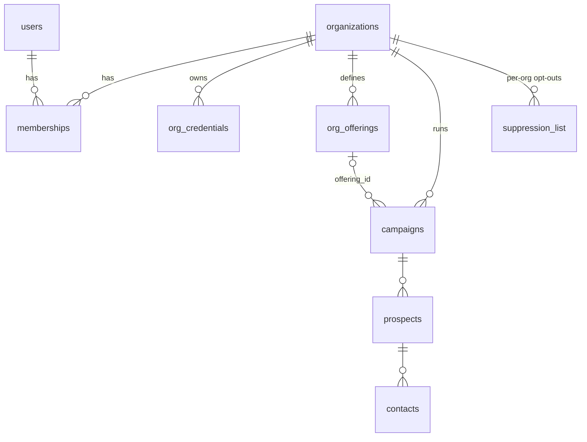

# AI Sales Agent — SaaS Architecture

How the single-operator Appson Sales platform becomes a multi-tenant SaaS:
any company, in any industry and any country, signs up and gets leads in
one of two ways: **describe its ideal customer to the AI agent**, or
**upload an Excel/CSV of the people it wants to reach**. It then picks
which channels to use (**Email, WhatsApp, LinkedIn, AI voice calls**, in
any combination) and the agent writes and talks to each prospect **in
that prospect's language**. This builds on
[architecture.md](architecture.md); everything not mentioned here stays as
described there.

Status (2026-11-13): design locked. `V16__organizations.sql` is written
and passed every check below on a throwaway Postgres 15 + Flyway 9. It has
not been applied to the VPS yet. Nothing else is built.

---

## Where we start

| Area | Today | SaaS needs |
|---|---|---|
| Tenancy | None. Only `campaigns.created_by` and `user_settings.user_id`; no org anywhere in V1–V15. | `organizations` + `memberships`, `org_id` on every tenant table, enforced by Postgres row-level security. |
| Credentials | One global `.env`: one Twilio, one Gmail, one Heyreach, one Apollo, one Anthropic key. | Per-tenant encrypted credential vault. |
| ICP / offering | Hardcoded service lines (`staff_augmentation`, `ai_consulting`) and routing from V13, baked into `services/api/src/lib/campaignPlanner.ts`. | Tenant-defined offering, ICP, tone and routing, generated from a prompt and stored as data. |
| Lead source | Apollo discovery from the planner's ICP only. | AI discovery from a prompt **or** a customer-uploaded Excel/CSV, landing in the same tables. |
| Channels | Email, WhatsApp, LinkedIn. Choice is implicit: the planner proposes `channels_enabled` and each `sequence_steps` row has a channel. No voice code. | An explicit per-campaign channel set the customer controls, plus a new AI voice channel. |
| Language | English only; prompts and opt-out handling assume English. | Per-org default language, per-prospect language, messages and calls generated natively in that language. |
| Auth | One operator (`AUTH_MODE=local`, bcrypt hash in env). | Signup, invites, roles, org-scoped sessions. |
| Billing / limits | None. | Plans, usage metering, per-tenant quotas. |
| Compliance | Global suppression list, basic compliance log. | Per-tenant suppression, quiet hours, India DLT/TRAI, WhatsApp opt-in, call-recording consent. |

---

## Decisions locked

1. **BYO first.** Each tenant connects its own Twilio / email / Heyreach /
   Apollo / enrichment / Anthropic accounts. A managed (resold) tier is a
   later upsell. This keeps us from becoming a telecom/WhatsApp reseller
   (deliverability, Meta business verification, DLT/TRAI liability) while
   we land the first paying customers.
2. **Own voice stack, no voice-AI vendor.** (Changed 2026-11-13; this
   replaces the earlier "use Vapi / Retell" plan.) We build our own
   speech pipeline, ElevenLabs-class, to avoid a third-party dependency.
   Design is still to be discussed; see [Voice channel](#voice-channel).
3. **Two lead sources, one pipeline.** Customers either prompt the AI
   agent (ICP → discovery) or upload an Excel/CSV of their own contacts.
   Both produce ordinary `prospects` / `contacts` rows, so everything
   downstream (research, generation, compliance, sending, inbox) is shared.
4. **Customer chooses the channels** per campaign: any subset of email,
   WhatsApp, LinkedIn and voice (e.g. all four, WhatsApp + email only, or
   voice only). The AI may suggest a set; the customer has the final say.
5. **Multi-language from the start.** Tenants and prospects can be in any
   country. Language is stored per org, per campaign and per contact, and
   content is generated directly in the target language, not translated
   afterwards.
6. **First slice = tenancy foundation + lead sources (prompt and upload)
   + channel choice + language fields.** Together they deliver "any
   company can sign up, bring or find leads, and reach them on the
   channels and in the language it wants". Voice starts only after
   tenancy is solid.

---

## Build order

| # | Phase | Main deliverables |
|---|---|---|
| 1 | Tenancy | V16 schema (this doc), org-scoped JWT, tenant context per DB connection, V17 RLS, credential vault replacing `.env` keys |
| 2 | Lead sources, channels, language | Prompt-to-ICP (`campaignPlanner.ts` reads/writes `org_offerings`); Excel/CSV import with column mapping; explicit `campaigns.channels`; language columns and language-aware generation |
| 3 | Onboarding + connectors | Signup, invite flow, setup wizard: email → WhatsApp → LinkedIn, each with a "verify credential" step |
| 4 | Voice channel (own stack) | Speech pipeline design session first; then `voice_channel.py` per the CLAUDE.md "new channel" checklist, call outcomes into the unified inbox, human handoff |
| 5 | Billing + quotas | Stripe plans, metering per enriched lead / message / call-minute, quota enforcement in the rate limiter |
| 6 | Per-tenant compliance | Org-scoped opt-out in every language, quiet hours by recipient timezone, DLT/TRAI templates, recording-consent prompts, consent attestations on uploaded lists |
| 7 | Hardening | Production dashboard build (not the Vite dev server), offsite backups, monitoring/alerting |

---

## Tenancy model

### New tables (V16)

- **`organizations`** — `id`, `name`, `slug` (unique), `plan`
  (`free|starter|growth|scale|enterprise`), `status`
  (`ACTIVE|SUSPENDED|CANCELLED`).
- **`users`** — global identity; email unique case-insensitively;
  `password_hash` nullable (SSO / invite-pending users).
- **`memberships`** — `(org_id, user_id)` PK, `role`
  `owner|admin|member|viewer`. A user can belong to several orgs.
- **`org_credentials`** — the BYO vault. One row per
  `(org_id, provider, label)`. `secret_enc bytea` is AES-256-GCM ciphertext
  produced by the API before insert (key from env / KMS); Postgres never
  sees plaintext. `meta jsonb` holds non-secret config (from-number,
  sender address, account id). `status` tracks verification.
- **`org_offerings`** — what a tenant sells: `value_proposition`, `tone`,
  `icp jsonb`, `routing jsonb`, and the `source_prompt` it was generated
  from. Replaces the V13 hardcoded service lines for new tenants.

### `org_id` everywhere

`org_id uuid NOT NULL REFERENCES organizations(id)` plus an index is added
to 13 tables: `campaigns`, `prospects`, `contacts`, `messages`,
`conversations`, `conversation_messages`, `meetings`, `suppression_list`,
`compliance_log`, `user_settings`, `prospect_events`, `campaign_audit_log`,
`inbound_events`. `campaigns` also gets `offering_id`, with a composite FK
`(offering_id, org_id) → org_offerings(id, org_id)` so a campaign can only
use an offering from its own org.

The other cross-table FKs (`prospects.campaign_id`, `contacts.prospect_id`,
…) are still single-column, so the schema alone does not stop a row from
pointing at a parent in another org. V17's RLS is what enforces isolation
for those.

Not stamped: `sequence_steps` and `campaign_templates` (only reached via
their campaign) and `poller_state` (process-global).

### Legacy tenant

All existing data is assigned to a fixed legacy org so nothing moves:

| | id | notes |
|---|---|---|
| Org | `00000000-0000-0000-0000-0000000000a1` | slug `appson`, plan `enterprise` |
| Owner user | `00000000-0000-0000-0000-000000000001` | matches the `AUTH_USER_ID` / `DEV_USER_ID` default in `services/api/src/env.ts` |

### Suppression becomes per-org

The three V6 partial unique indexes are rebuilt with `org_id` as the
leading column. One tenant's opt-out must never block, or reveal anything
to, another tenant. App inserts use bare `ON CONFLICT DO NOTHING`, so they
keep working unchanged.

> Open question for phase 6: a global "hard bounce / spam complaint" list
> shared across tenants protects shared sending infrastructure in the
> managed tier. Not needed while every tenant is BYO.

---

## Rollout: two migrations, not one

**V16 (done)** is purely additive. Every new `org_id` has
`DEFAULT '…00a1'`, so the current API, orchestrator and workers, none of
which pass `org_id` yet, keep inserting valid rows into the legacy org.
It is safe to deploy before any code change.

**V17 (after app changes)**:
1. API resolves the org from the JWT (`org_id` + `role` claims) and runs
   every request inside a transaction with
   `SET LOCAL app.current_org = '<uuid>'`. **Done (2026-11-13):**
   `services/api/src/lib/tenantContext.ts` (AsyncLocalStorage),
   `middleware/auth.ts` (org + role for bypass / local / Cognito; sessions
   without `org_id` fall back to `AUTH_ORG_ID`), `db/client.ts`
   (`set_config('app.current_org', org, true)` at the start of every
   transaction when a tenant is set). Routes needed no changes. Cost: a
   plain `query()` inside a request now takes 3 extra round trips
   (BEGIN, set_config, COMMIT); revisit if latency shows up.
2. Orchestrator / workers set the same setting from the campaign they are
   processing.
3. Only then: replace the `org_id` defaults with
   `DEFAULT current_setting('app.current_org')::uuid` (so existing INSERTs
   that omit `org_id` land in the caller's org without code changes, and
   fail loudly when no tenant is set), `ENABLE` + `FORCE ROW LEVEL
   SECURITY` with a `USING (org_id = current_setting('app.current_org')::uuid)`
   policy on each stamped table, and run the app under a non-owner role
   (table owners bypass RLS).

Enabling RLS before steps 1–2 ship would make every query return zero rows
in production.

Things to resolve in V17:
- `user_settings` is keyed by `user_id` alone; a user in two orgs needs
  `(org_id, user_id)`. `routes/settings.ts` uses `ON CONFLICT (user_id)`,
  so the key change ships together with that code change.
- `conversations` is unique on `(contact_id, channel)`; contacts are
  already per-org, so this is fine as-is.

---

## Credentials: the vault vs. CLAUDE.md principle 2

CLAUDE.md principle 2 says *all third-party credentials come from
environment variables*. With BYO, tenant credentials live in
`org_credentials` instead. Proposed amendment: **platform** secrets (DB,
vault encryption key, internal tokens) stay env-only; **tenant** secrets
live only as ciphertext in `org_credentials`, decrypted in memory at send
time, never logged, never returned by the API. The principle needs updating
in CLAUDE.md before phase 1 code lands.

Channel classes gain a `from_credentials(org_id)` factory alongside the
planned `from_environment()`; the legacy org keeps reading `.env` until its
keys are moved into the vault.

---

## Lead sources

A campaign gets its prospects from one of two sources (a later version
can allow both on one campaign). Each `prospects` / `contacts` row records
where it came from (`source` = `ai_discovery` | `file_import`, plus
`import_id` for uploads).

### A. Prompt-to-ICP (AI discovery)

1. Tenant describes the business and ideal customer in free text.
2. `campaignPlanner.ts` (already an LLM planner) gets a new mode that
   returns a structured offering: value proposition, tone, ICP filters
   (titles, industries, sizes, geos, signals) and routing rules.
3. Result is saved to `org_offerings` with the original prompt in
   `source_prompt`; the tenant edits and approves.
4. Campaigns reference it via `campaigns.offering_id`. Routing reads
   `org_offerings.routing` instead of the V13 `service_line` enum. The
   legacy org's two service lines are migrated into two `org_offerings`
   rows.

### B. Excel / CSV upload

1. **Upload** an `.xlsx` or `.csv` to a campaign. The original file is
   kept in object storage, scoped to the org.
2. **Map columns.** The AI suggests a mapping from the sheet's headers (in
   any language) to our fields: name, company, title, email, phone /
   WhatsApp, LinkedIn URL, country, language, plus free-form extra
   columns kept as `enrichment_data` for personalisation. The customer
   confirms or fixes it.
3. **Validate and clean.** Normalise phones to E.164 (using the row's
   country, or the org's default), check email syntax, dedupe within the
   file and against the org's existing contacts, and drop anyone on the
   org's suppression list. Bad rows are reported per row, not silently
   skipped.
4. **Consent attestation.** The customer confirms they have a lawful
   basis to contact these people, and WhatsApp opt-in where required. The
   attestation is stored with the import, because uploaded lists carry
   compliance risk that AI-discovered public B2B contacts don't.
5. **Preview and import.** Rows become `prospects` + `contacts` with
   `source = 'file_import'`. Enrichment only fills fields the sheet left
   empty; research and message generation run exactly as for discovered
   leads.

Import runs as a background job so large files don't block the API. A
`lead_imports` table tracks file, mapping, row counts (total / imported /
duplicate / invalid / suppressed), status and the consent attestation.

---

## Channel selection

- `campaigns.channels channel_type[]`: the customer's chosen set, any
  non-empty subset of `email`, `whatsapp`, `linkedin`, `voice`.
- In prompt mode the planner proposes a set (today's `channels_enabled`);
  the customer edits it before approving. Upload mode starts with every
  channel the sheet has data for.
- Sequence steps may only use channels in the set (API validation plus a
  DB check).
- **Activation gate:** a campaign can't go ACTIVE unless each chosen
  channel has a `VERIFIED` credential in `org_credentials`.
- **Per-contact eligibility:** a contact with no phone number skips
  WhatsApp and voice steps; one with no email skips email. The sequence
  falls through to the next eligible step instead of failing.
- Rate limits and quotas stay per channel and become per org.

---

## Multi-language

Tenants and prospects can be anywhere, so language and region are data,
not assumptions.

| Level | Fields | Used for |
|---|---|---|
| Org | `default_language` (BCP 47, e.g. `en`, `hi`, `es-MX`), `default_country`, `timezone` | Defaults for imports and new campaigns; dashboard language later |
| Campaign | `languages` (allowed set) or "auto" | Restrict or let each prospect's language decide |
| Contact | `language`, `country`, `timezone` | From the upload, enrichment, or inferred from country; drives generation and quiet hours |
| Message / call | `language` | Analytics per language, and audit of what was actually sent |

Rules:
- **Generate natively.** Prompts tell the model to write in the contact's
  language and cultural register (formality, name order, greeting
  conventions), rather than writing English and translating it.
- **Opt-out in every language.** "STOP", "रुको", "ALTO", "unsubscribe"
  equivalents and free-text refusals are classified by the model in any
  language, then written to `suppression_list`. The opt-out confirmation
  is sent in the contact's language. This is a compliance requirement, not
  polish.
- **Quiet hours use the recipient's timezone**, not the tenant's.
- **WhatsApp templates are per language.** Meta approves each template per
  language, so a campaign needs an approved template for each language it
  will open with.
- **Voice** needs speech recognition and synthesis for every language we
  sell into. This is the biggest input to the own-voice-stack design.
- Postgres is UTF-8 throughout, so storage needs no special handling.
- Dashboard UI translation (i18n) comes later; content language comes
  first.

---

## Voice channel

**Decision:** we build our own voice stack (ElevenLabs-class) rather than
depend on a voice-AI vendor. The detailed design is a separate discussion
before phase 4. Points that design must settle:

- **Pipeline:** telephony audio in → speech-to-text → the existing
  conversation agent (LLM) → text-to-speech → audio out, streaming end to
  end.
- **Latency:** a natural call needs roughly under a second from the
  prospect finishing a sentence to hearing a reply, which drives model
  choice, streaming, and GPU placement near the telephony region.
- **Languages and voices:** speech-to-text and text-to-speech quality for
  each target language (Hindi/Hinglish first, then others); voice
  cloning only with the voice owner's recorded consent.
- **Hosting:** self-hosted GPU inference and its cost per call-minute.
- **Telephony still needs a carrier.** Owning the speech stack removes
  the voice-AI vendor, but reaching real phone numbers still requires a
  carrier or SIP trunk (the tenant's Twilio, or a regional carrier). That
  part stays BYO.

Unchanged from before, whatever the stack:
- Follows the CLAUDE.md new-channel checklist: `voice_channel.py`,
  `ChannelRegistry`, rate limits, validator rules, webhook route.
- `channel_type` enum gains `voice` (needs `ALTER TYPE … ADD VALUE`, its own
  migration).
- Call outcome (connected / voicemail / interested / not interested /
  opt-out) and transcript go to `messages` / `conversation_messages`, so
  the unified inbox and funnel work unchanged.
- Compliance: recording-consent disclosure at call start (in the callee's
  language), quiet hours by recipient timezone, DND/DLT checks for Indian
  numbers, spoken opt-out writes to `suppression_list`.

---

## Schema still to come

V16 is committed and is not edited (CLAUDE.md principle 7). The new
requirements land in later forward-only migrations, numbered when written:

| Change | For |
|---|---|
| `organizations.default_language`, `default_country`, `timezone` | Multi-language |
| `contacts.language`, `country`, `timezone`; `messages.language` | Multi-language |
| `campaigns.languages` | Multi-language |
| `campaigns.channels channel_type[]` + check on `sequence_steps.channel` | Channel selection |
| `channel_type` gains `voice` | Voice (own migration: `ALTER TYPE … ADD VALUE` can't share a transaction with its first use) |
| `lead_imports` table; `prospects.source`, `contacts.source`, `import_id` | Excel/CSV upload |
| `calls` table (duration, recording key, transcript, outcome) | Voice |
| Drop `org_id` defaults, enable + force RLS, `user_settings` key `(org_id, user_id)` | V17 tenancy cut-over |

---

## Testing V16

Run against a throwaway container, never the VPS first:

1. Fresh `postgres:15-alpine`; Flyway `migrate -target=15`.
2. Seed a campaign → prospect → contact → message → suppression row.
3. Flyway `migrate` (applies V16).
4. Check: backfill to legacy org, app-style inserts without `org_id` still
   succeed, same email suppressible in two orgs, duplicates within one org
   still rejected, `ON CONFLICT DO NOTHING` and
   `ON CONFLICT (user_id)` still behave.

Before deploying to the VPS: take a `pg_dump`, then run Flyway as usual.
