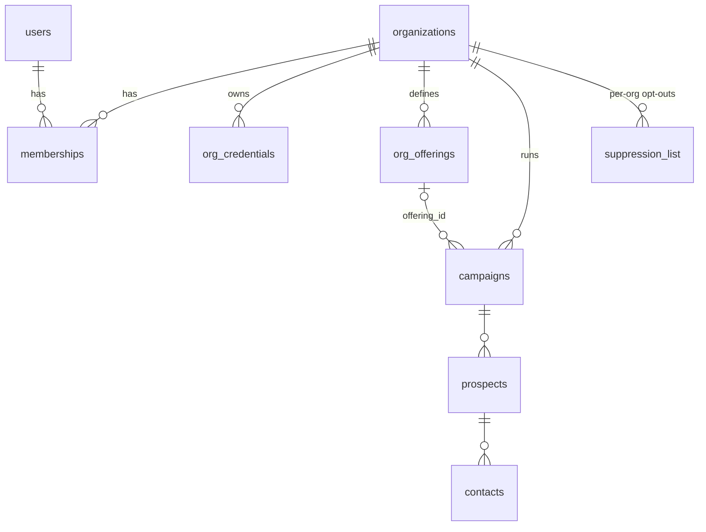

# AI Sales Agent — SaaS Architecture

How the single-operator Appson Sales platform becomes a multi-tenant SaaS:
any company, in any industry and any country, signs up and gets leads in
one of two ways: **describe its ideal customer to the AI agent**, or
**upload an Excel/CSV of the people it wants to reach**. It then picks
which channels to use (**Email, WhatsApp, AI voice calls**, in any
combination) and the agent writes and talks to each prospect **in that
prospect's language**. LinkedIn outreach stays an Appson-internal channel
and is not offered to customers. This builds on
[architecture.md](architecture.md); everything not mentioned here stays as
described there.

Status (2026-11-13): **phase 1 (tenancy) is built and tested; nothing is
deployed to the VPS yet.** V16 (schema), API + orchestrator tenant
context, V17 (row-level security) and the credential vault all pass their
tests on throwaway Postgres 15 + Flyway 9, with the services connected as
the non-superuser app role. Deploy steps: [V17 deploy
runbook](#v17-deploy-runbook).

---

## Where we start

| Area | Today | SaaS needs |
|---|---|---|
| Tenancy | None. Only `campaigns.created_by` and `user_settings.user_id`; no org anywhere in V1–V15. | `organizations` + `memberships`, `org_id` on every tenant table, enforced by Postgres row-level security. |
| Credentials | One global `.env`: one Twilio, one Gmail, one Heyreach, one Apollo, one Anthropic key. | Per-tenant encrypted credential vault. |
| ICP / offering | Hardcoded service lines (`staff_augmentation`, `ai_consulting`) and routing from V13, baked into `services/api/src/lib/campaignPlanner.ts`. | Tenant-defined offering, ICP, tone and routing, generated from a prompt and stored as data. |
| Lead source | Apollo discovery from the planner's ICP only. | AI discovery from a prompt **or** a customer-uploaded Excel/CSV, landing in the same tables. |
| Channels | Email, WhatsApp, LinkedIn. Choice is implicit: the planner proposes `channels_enabled` and each `sequence_steps` row has a channel. No voice code. | Customers: an explicit per-campaign set of email / WhatsApp / AI voice (new). LinkedIn stays for Appson only. |
| Language | English only; prompts and opt-out handling assume English. | Per-org default language, per-prospect language, messages and calls generated natively in that language. |
| Auth | One operator (`AUTH_MODE=local`, bcrypt hash in env). | Signup, invites, roles, org-scoped sessions. |
| Billing / limits | None. | Plans, usage metering, per-tenant quotas (built: slices 4.1 / 4.2). |
| Compliance | Global suppression list, basic compliance log. | Per-tenant suppression, quiet hours, India DLT/TRAI, WhatsApp opt-in, call-recording consent. |

---

## Decisions locked

1. **BYO first.** Each tenant connects its own Twilio / email / Apollo /
   enrichment / Anthropic accounts (and a phone number for voice). A managed (resold) tier is a
   later upsell. This keeps us from becoming a telecom/WhatsApp reseller
   (deliverability, Meta business verification, DLT/TRAI liability) while
   we land the first paying customers.
2. **Own voice stack, no voice-AI vendor.** (Changed 2026-11-13; this
   replaces the earlier "use Vapi / Retell" plan.) We build our own
   speech pipeline, ElevenLabs-class, to avoid a third-party dependency.
   Design is still to be discussed; see [Voice channel](#voice-channel).
3. **Two lead sources, one pipeline.** Customers either prompt the AI
   agent (ICP → discovery) or upload an Excel/CSV of their own contacts.
   Both produce ordinary `prospects` / `contacts` rows, so everything
   downstream (research, generation, compliance, sending, inbox) is shared.
4. **Customer chooses the channels** per campaign: any subset of email,
   WhatsApp and voice (e.g. all three, WhatsApp + email only, or voice
   only). The AI may suggest a set; the customer has the final say.
   **LinkedIn is Appson-internal only** (decided 2026-11-13): Appson's own
   team keeps using it through Heyreach; general customers never see it.
   It is a per-org entitlement, not something a customer can switch on.
5. **Multi-language from the start.** Tenants and prospects can be in any
   country. Language is stored per org, per campaign and per contact, and
   content is generated directly in the target language, not translated
   afterwards.
6. **First slice = tenancy foundation + lead sources (prompt and upload)
   + channel choice + language fields.** Together they deliver "any
   company can sign up, bring or find leads, and reach them on the
   channels and in the language it wants". Voice starts only after
   tenancy is solid.

---

## Build order

| # | Phase | Main deliverables |
|---|---|---|
| 1 | Tenancy | V16 schema (this doc), org-scoped JWT, tenant context per DB connection, V17 RLS, credential vault replacing `.env` keys |
| 2 | Lead sources, channels, language | In slices: **2.1 channels + language foundation (done)** · **2.2 Excel/CSV import backend (done)** · **2.3 prompt-to-ICP offerings (done)** · **2.4 language-aware writing + multilingual opt-out (done)** · **2.5 dashboard screens (done)** |
| 3 | Onboarding + connectors | Signup + sign-in, invite flow, onboarding wizard that builds the **business profile** (see "Business profile and onboarding"), then connect email → WhatsApp → phone number (voice), each with a "verify credential" step |
| 4 | Voice channel (own stack) | Speech pipeline design session first; then `voice_channel.py` per the CLAUDE.md "new channel" checklist, call outcomes into the unified inbox, human handoff |
| 5 | Billing + quotas (built, slices 4.1 / 4.2) | Stripe plans, metering per enriched lead / message / call-minute, quota enforcement in the rate limiter |
| 6 | Per-tenant compliance (built in part, slices 5.1 / 5.2) | Org-scoped opt-out in every language, quiet hours by recipient timezone, DLT/TRAI templates, recording-consent prompts, consent attestations on uploaded lists |
| 7 | Hardening | Production dashboard build (not the Vite dev server), offsite backups, monitoring/alerting |

---

## Tenancy model

### New tables (V16)

- **`organizations`** — `id`, `name`, `slug` (unique), `plan`
  (`free|starter|growth|scale|enterprise`), `status`
  (`ACTIVE|SUSPENDED|CANCELLED`).
- **`users`** — global identity; email unique case-insensitively;
  `password_hash` nullable (SSO / invite-pending users).
- **`memberships`** — `(org_id, user_id)` PK, `role`
  `owner|admin|member|viewer`. A user can belong to several orgs.
- **`org_credentials`** — the BYO vault. One row per
  `(org_id, provider, label)`. `secret_enc bytea` is AES-256-GCM ciphertext
  produced by the API before insert (key from env / KMS); Postgres never
  sees plaintext. `meta jsonb` holds non-secret config (from-number,
  sender address, account id). `status` tracks verification.
- **`org_offerings`** — what a tenant sells: `value_proposition`, `tone`,
  `icp jsonb`, `routing jsonb`, and the `source_prompt` it was generated
  from. Replaces the V13 hardcoded service lines for new tenants.

### `org_id` everywhere

`org_id uuid NOT NULL REFERENCES organizations(id)` plus an index is added
to 13 tables: `campaigns`, `prospects`, `contacts`, `messages`,
`conversations`, `conversation_messages`, `meetings`, `suppression_list`,
`compliance_log`, `user_settings`, `prospect_events`, `campaign_audit_log`,
`inbound_events`. `campaigns` also gets `offering_id`, with a composite FK
`(offering_id, org_id) → org_offerings(id, org_id)` so a campaign can only
use an offering from its own org.

The other cross-table FKs (`prospects.campaign_id`, `contacts.prospect_id`,
…) are still single-column, so the schema alone does not stop a row from
pointing at a parent in another org. V17's RLS is what enforces isolation
for those.

Not stamped: `sequence_steps` and `campaign_templates` (only reached via
their campaign) and `poller_state` (process-global).

### Legacy tenant

All existing data is assigned to a fixed legacy org so nothing moves:

| | id | notes |
|---|---|---|
| Org | `00000000-0000-0000-0000-0000000000a1` | slug `appson`, plan `enterprise` |
| Owner user | `00000000-0000-0000-0000-000000000001` | matches the `AUTH_USER_ID` / `DEV_USER_ID` default in `services/api/src/env.ts` |

### Suppression becomes per-org

The three V6 partial unique indexes are rebuilt with `org_id` as the
leading column. One tenant's opt-out must never block, or reveal anything
to, another tenant. App inserts use bare `ON CONFLICT DO NOTHING`, so they
keep working unchanged.

> Open question for phase 6: a global "hard bounce / spam complaint" list
> shared across tenants protects shared sending infrastructure in the
> managed tier. Not needed while every tenant is BYO.

---

## Rollout: two migrations, not one

**V16 (done)** is purely additive. Every new `org_id` has
`DEFAULT '…00a1'`, so the current API, orchestrator and workers, none of
which pass `org_id` yet, keep inserting valid rows into the legacy org.
It is safe to deploy before any code change.

**V17 (after app changes)**:
1. API resolves the org from the JWT (`org_id` + `role` claims) and runs
   every request inside a transaction with
   `SET LOCAL app.current_org = '<uuid>'`. **Done (2026-11-13):**
   `services/api/src/lib/tenantContext.ts` (AsyncLocalStorage),
   `middleware/auth.ts` (org + role for bypass / local / Cognito; sessions
   without `org_id` fall back to `AUTH_ORG_ID`), `db/client.ts`
   (`set_config('app.current_org', org, true)` at the start of every
   transaction when a tenant is set). Routes needed no changes. Cost: a
   plain `query()` inside a request now takes 3 extra round trips
   (BEGIN, set_config, COMMIT); revisit if latency shows up.
2. Orchestrator / workers set the same setting from the campaign they are
   processing. **Done (2026-11-13)** for the orchestrator and all cron
   scripts: `services/orchestrator/src/db/tenant.py` keeps the org in a
   `ContextVar`; its `create_pool()` adds an asyncpg `setup` hook that sets
   (or clears) `app.current_org` on every connection checkout, so nothing
   leaks between borrowers.
   - Poller (`poller.py`): reads each pending campaign's `org_id` and runs
     that campaign's task as its org; concurrent campaigns from different
     orgs stay separate (covered by a live test).
   - Per-campaign scripts (send emails / WhatsApp / Heyreach, rolling
     fetch, enrich, regenerate, rewrite drafts): `use_campaign_org()` at
     start, then the whole run is that org.
   - Shared-inbox scripts: `poll_email_replies.py` records each reply as
     the matched contact's org; `process_inbound_events.py` handles each
     event as its row's `org_id`.
   - Not wired: `outreach-worker` and `reply-processor` (the SQS path, idle
     on the Hetzner deploy).
3. **Done (2026-11-13): `V17__row_level_security.sql`.**
   - `app_current_org()` = `NULLIF(current_setting('app.current_org',
     true), '')::uuid`; "no tenant" means NULL, never an error.
   - `org_id DEFAULT app_current_org()` on all 16 tenant tables: INSERTs
     that omit `org_id` land in the caller's org; with no tenant they are
     refused instead of landing in the legacy org.
   - RLS ENABLEd + FORCEd with a `tenant_isolation` policy (`org_id =
     app_current_org()`, USING and WITH CHECK) on every tenant table;
     `sequence_steps` / `campaign_templates` follow their campaign;
     `organizations` shows only the current org; `users` only its
     members. `poller_state` stays global.
   - The V7 views are `security_invoker`, so they obey RLS.
   - Cross-org lookups are narrow `SECURITY DEFINER` functions, EXECUTE
     revoked from PUBLIC: `org_of_campaign`, `org_of_contact`,
     `org_of_message`, `pending_campaigns`, `match_email_reply`,
     `unprocessed_inbound_events`, `org_of_provider_account`.
   - Group role `sales_app` (no login, no superuser, no BYPASSRLS) with
     table/function grants and default privileges for later migrations;
     the login is created outside migrations by
     `scripts/db/create_app_login.sh` (password from env).
   - `user_settings` primary key is now `(org_id, user_id)`.
   - Code shipped with it: webhooks, the unsubscribe link and the open
     pixel resolve the org from the referenced contact / message / Twilio
     AccountSid (`services/api/src/lib/tenantLookup.ts`) and write as that
     org; the orchestrator's four cross-org reads call the functions;
     `dev_seed.sql` sets the legacy tenant first.
   - Tested as the non-superuser login: SQL isolation checks (no tenant
     sees nothing; one org cannot read, write, update or move another
     org's rows), the API and orchestrator live suites, the dev seed.

**Superusers always bypass RLS, even when FORCEd.** Isolation is only real
once the services' `DATABASE_URL` uses the `sales_app` login. Until then
V17 behaves like V16 except that untenanted inserts fail.

Still open:
- ~~Heyreach / LinkedIn webhooks need per-tenant routing.~~ Not needed:
  LinkedIn is Appson-internal only, so routing those webhooks to
  `AUTH_ORG_ID` (the Appson org) is correct by design.
- `outreach-worker` and `reply-processor` (the SQS path, idle on Hetzner)
  are not tenant-aware; they must be before any AWS deploy.
- Signup (creating orgs and users) will need SECURITY DEFINER functions:
  `organizations` and `users` only accept rows for the current tenant.

### V17 deploy runbook

Order matters: the new code needs V17's functions, and V17 refuses
untenanted inserts from old code.

1. `pg_dump` the production database.
2. Pause the crons (`crontab -l > ~/cron.bak && crontab -r`) and stop the
   api + orchestrator containers.
3. `docker compose run --rm flyway migrate` (still as the owner account):
   applies V16, V17 and the phase 2 migrations (V18, V19, …).
4. Deploy the new code and start api + orchestrator. Restore the crons.
   Smoke test: log in, open a campaign, send one test email, check the
   inbox poller log. RLS is not enforced yet (superuser connection).
5. `SALES_APP_DB_PASSWORD=… scripts/db/create_app_login.sh`, switch the
   api + orchestrator `DATABASE_URL` to `sales_app_login`, restart.
   Repeat the smoke test: now isolation is enforced. Rollback for this
   step is switching `DATABASE_URL` back.
6. Set `CREDENTIALS_KEY` (base64 of 32 random bytes) before anyone saves
   a connected account; store it with the DB backups.

---

## Credentials: the vault

**Built (2026-11-13).** CLAUDE.md principle 2 is amended: **platform**
secrets (DB, `CREDENTIALS_KEY`, internal tokens) stay env-only; **tenant**
secrets live only as ciphertext in `org_credentials`, decrypted in memory
at use, never logged, never returned by the API. Principle 8 records the
tenant-isolation rules.

- **Format** (`secret_enc`): `0x01 | iv(12) | tag(16) | ciphertext`,
  AES-256-GCM, key = base64 `CREDENTIALS_KEY` (32 bytes), plaintext =
  compact UTF-8 JSON of the secret fields, AAD =
  `<org_id>:<provider>:<label>` so a ciphertext only opens for its own row.
  Node (`services/api/src/lib/vault.ts`) and Python
  (`services/orchestrator/src/db/vault.py`) are pinned to one shared test
  vector.
- **API** (`routes/credentials.ts`): `GET /api/credentials` lists the
  org's connections with `has_secret` but never the secret;
  `PUT /api/credentials/:provider` (owner/admin) saves `{label, secret,
  meta}` and resets status to UNVERIFIED; `DELETE /api/credentials/:id`
  (owner/admin) wipes the secret and marks the row REVOKED. Twilio
  requires `meta.account_id` (the Account SID) because inbound webhooks
  are routed by it.
- **Workers**: `db.vault.load_credential(conn, provider, label)` inside a
  tenant returns the decrypted credential (`repr` redacts it).
- **Key management**: losing `CREDENTIALS_KEY` makes every stored secret
  unreadable; back it up with the database credentials. Rotation (a
  second key id via the version byte) is not built yet.

Not yet done (onboarding, phase 3): "Verify" calls to each provider,
channel classes reading `load_credential()` instead of `.env`
(`from_credentials()` next to `from_environment()`), and moving the legacy
org's `.env` keys into the vault.

---

## Lead sources

A campaign gets its prospects from one of two sources (a later version
can allow both on one campaign). Each `prospects` / `contacts` row records
where it came from (`source` = `ai_discovery` | `file_import`, plus
`import_id` for uploads).

### A. Prompt-to-ICP (AI discovery)

1. Tenant describes the business and ideal customer in free text.
2. `campaignPlanner.ts` (already an LLM planner) gets a new mode that
   returns a structured offering: value proposition, tone, ICP filters
   (titles, industries, sizes, geos, signals) and routing rules.
3. Result is saved to `org_offerings` with the original prompt in
   `source_prompt`; the tenant edits and approves.
4. Campaigns reference it via `campaigns.offering_id`. Routing reads
   `org_offerings.routing` instead of the V13 `service_line` enum. The
   legacy org's two service lines are migrated into two `org_offerings`
   rows.

**Built (slice 2.3, 2026-11-13)**, with two deliberate changes to the plan
above: offerings got their own generator (`services/api/src/lib/offering.ts`)
instead of a new mode in Appson's `campaignPlanner.ts`, and Appson's two
service lines were *not* migrated into offerings. Appson keeps its
existing playbook untouched; it can opt into offerings per campaign.

- **API** (`routes/offerings.ts`): `POST /api/offerings/generate
  {description}` → draft (offering + suggested channels within the
  entitlement + suggested languages + campaign goal), not saved; CRUD on
  `/api/offerings` (owners/admins/members write; delete refused while a
  campaign uses it). The description may be in any language; the draft
  is in English. The generator prompt forbids invented clients, numbers
  or certifications; output is validated with Zod (422 if unusable).
- **Offering shape**: `value_proposition`, `tone`, `icp {titles,
  industries, company_sizes, countries (English names for Apollo),
  keywords}`, `routing {angles: [{label, fits, lead_with,
  proof_points}], cta, guardrails}`.
- **Campaigns**: `offering_id` on create/update; tone, value proposition
  and ICP default from the offering. Another org's offering → 400 (RLS +
  composite FK). `POST /api/campaigns/plan` (Appson's planner) now
  answers 409 for customers and points to the offering generator.
- **Writer** (`smoke_test_campaign.py`): `build_prompt()` uses Appson's
  original service-line prompt + router only for the operator org's
  campaigns without an offering. Every other campaign gets a generic
  prompt built from its offering: pick the best-fitting angle, cite only
  its proof points, ask for its CTA, obey its guardrails. No Appson
  service lines, positioning or routing (`pitch_type` NULL). The fallback
  template for customers makes no claims.
- **Whose key pays (BYO)**: generation, discovery and writing use the
  org's own Anthropic / Apollo accounts from the vault
  (`lib/providerKeys.ts`, `db/provider_keys.py`); the env-configured
  operator org uses `.env`. A customer with no connected account gets 409
  (API) or a skipped run with a reason (orchestrator), never the
  platform's credits.

Not yet: messages in the prospect's language (slice 2.4); sending
channels (SMTP / Twilio) still read `.env` until the onboarding phase
wires `from_credentials()`.

### B. Excel / CSV upload

1. **Upload** an `.xlsx` or `.csv` to a campaign. The original file is
   kept in object storage, scoped to the org.
2. **Map columns.** The AI suggests a mapping from the sheet's headers (in
   any language) to our fields: name, company, title, email, phone /
   WhatsApp, country, language, plus free-form extra
   columns kept as `enrichment_data` for personalisation. The customer
   confirms or fixes it.
3. **Validate and clean.** Normalise phones to E.164 (using the row's
   country, or the org's default), check email syntax, dedupe within the
   file and against the org's existing contacts, and drop anyone on the
   org's suppression list. Bad rows are reported per row, not silently
   skipped.
4. **Consent attestation.** The customer confirms they have a lawful
   basis to contact these people, and WhatsApp opt-in where required. The
   attestation is stored with the import, because uploaded lists carry
   compliance risk that AI-discovered public B2B contacts don't.
5. **Preview and import.** Rows become `prospects` + `contacts` with
   `source = 'file_import'`. Enrichment only fills fields the sheet left
   empty; research and message generation run exactly as for discovered
   leads.

A `lead_imports` table tracks file, mapping, row counts (total / imported /
duplicate / invalid / suppressed), status and the consent attestation.

**Built (slice 2.2, 2026-11-13).** V20 + `services/api/src/lib/leadImport.ts`
+ `routes/imports.ts` + `services/orchestrator/src/scripts/prepare_imported_leads.py`.

| Step | Endpoint | What happens |
|---|---|---|
| Upload | `POST /api/campaigns/:id/imports?filename=x.xlsx` (raw body) | `.xlsx` (first non-empty sheet) or `.csv` (`,` `;` tab `\|`, BOM ok). Max 10 MB, 10,000 rows, 100 columns. Rows stored in `lead_import_rows`; suggested mapping returned. |
| Map + validate | `PUT /api/imports/:id/mapping` | Mapping by column position (repeated headers work). Every row normalised; statuses READY / DUPLICATE / INVALID / SUPPRESSED with per-row `problems`. |
| Report | `GET /api/imports/:id/rows?status=INVALID` | Row-level report for the UI / download. |
| Commit | `POST /api/imports/:id/commit {consent: true}` | Consent text + who/when stored; READY rows become prospects + contacts (`source = 'file_import'`, `import_id`) and an `imported` timeline event, in one transaction. |
| Cancel | `DELETE /api/imports/:id` | Before commit only; deletes the stored rows. |

Rules as built:
- **Mapping suggestions**: header synonyms in English, Spanish, French,
  Portuguese, German, Italian, Arabic and Hindi (accent- and
  script-insensitive), then value sniffing (emails, phones, LinkedIn
  URLs). Each field is used once; notes may repeat. *Deterministic, not
  an LLM call*: free and predictable. An AI fallback for unrecognised
  headers can come later.
- **Cleaning**: name required (or first + last); email or phone required.
  Phones → E.164 using the row's country, else the import's default,
  else the org's `default_country`. Countries by ISO code or name in 8
  languages (`Perú`, `PER`, `الإمارات…`) → ISO-2 on the contact, English
  name on the prospect (market tiers read names). Languages by code or
  name (`Español`, `العربية`) → BCP 47. A bad email or phone is dropped
  with a warning if the other channel works. Company falls back to the
  website domain, then a work-email domain, then the person's name.
- **Duplicates / opt-outs**: same email or E.164 phone earlier in the
  file, or already a contact anywhere in the org → DUPLICATE; on the
  org's active suppression list → SUPPRESSED. (Exact match: older
  contacts with non-E.164 phones are not matched.)
- **After import** the poller picks ACTIVE campaigns with unprepared
  imported contacts (`campaigns_with_unwritten_imports()`) and, as the
  campaign's org, 25 contacts per campaign per tick
  (`IMPORT_PREPARE_BATCH`): optional research → routing → first-touch
  message on each chosen channel the contact can be reached on. The
  customer's note column becomes the personalisation hook. Contacts with
  no reachable channel get a `skipped` event. Either way `prepared_at` is
  set, so nobody is retried forever. No Apollo calls for imported leads.

Differences from the original plan: the file itself is not kept (only
name, size, SHA-256 and the parsed rows), since there is no object
storage on the Hetzner deploy; commit is synchronous (fine at ≤10,000
rows); languages are stored but messages are still written in English
until slice 2.4.

---

## Channel selection

**Built (slice 2.1, 2026-11-13):** V18 adds `voice` to `channel_type`;
V19 adds the columns and checks below; the API and orchestrator enforce
them.

- `campaigns.channels text[]`: the campaign's chosen set, any non-empty
  subset of `email`, `whatsapp`, `voice` for customers. (`text[]` with a
  CHECK on the allowed values, not `channel_type[]`: node-postgres returns
  custom-enum arrays as raw strings.) Existing campaigns were backfilled
  with the channels their steps and messages already use.
- `organizations.channels`: the entitlement. Customers default to
  `{email, whatsapp, voice}`; only the Appson org has `linkedin`. Read-only
  in the API (`GET /api/organization`).
- Enforced in three places: the API (campaign create/update, Heyreach
  credentials → 403 for customers), AI plans (LinkedIn steps dropped and
  renumbered for customers), and the database (deferred constraint
  triggers: campaign channels ⊆ org entitlement, step channel ∈ campaign
  channels, checked at COMMIT so channels and steps can change together).
- Message generation follows the campaign's channels
  (`campaign_text_channels()` in `smoke_test_campaign.py`): a "WhatsApp +
  email" campaign never gets LinkedIn drafts; mobile enrichment runs only
  when WhatsApp or voice is chosen. Voice has no text generator yet.
- In prompt mode the planner proposes a set (today's `channels_enabled`);
  the customer edits it before approving. Upload mode starts with every
  channel the sheet has data for (slice 2.2).
- **Launch gate:** `POST /launch` and `PATCH /status → ACTIVE` return
  409 with `details.missing` unless each chosen channel has a connected
  account (email: google_workspace/smtp/ses, whatsapp: twilio, voice:
  voice, linkedin: heyreach). Until provider verification ships (phase 3)
  "connected" = saved, not revoked, not failed. The env-configured
  operator org (`AUTH_ORG_ID`) sends with `.env` keys, so it is exempt.
- **Per-contact eligibility:** a contact with no phone number skips
  WhatsApp and voice steps; one with no email skips email. The sequence
  falls through to the next eligible step instead of failing.
- Rate limits and quotas stay per channel and become per org.

---

## Multi-language

Tenants and prospects can be anywhere, so language and region are data,
not assumptions.

| Level | Fields | Used for |
|---|---|---|
| Org | `default_language` (BCP 47, e.g. `en`, `hi`, `es-MX`), `default_country`, `timezone` | Defaults for imports and new campaigns; dashboard language later |
| Campaign | `languages` (allowed set) or "auto" | Restrict or let each prospect's language decide |
| Contact | `language`, `country`, `timezone` | From the upload, enrichment, or inferred from country; drives generation and quiet hours |
| Message / call | `language` | Analytics per language, and audit of what was actually sent |

Rules:
- **Generate natively.** Prompts tell the model to write in the contact's
  language and cultural register (formality, name order, greeting
  conventions), rather than writing English and translating it.
- **Opt-out in every language.** "STOP", "रुको", "ALTO", "unsubscribe"
  equivalents and free-text refusals are classified by the model in any
  language, then written to `suppression_list`. The opt-out confirmation
  is sent in the contact's language. This is a compliance requirement, not
  polish.
- **Quiet hours use the recipient's timezone**, not the tenant's.
- **WhatsApp templates are per language.** Meta approves each template per
  language, so a campaign needs an approved template for each language it
  will open with.
- **Voice** needs speech recognition and synthesis for every language we
  sell into. This is the biggest input to the own-voice-stack design.
- Postgres is UTF-8 throughout, so storage needs no special handling.
- Dashboard UI translation (i18n) comes later; content language comes
  first.

**Built (slice 2.4, 2026-11-13):**

- **Which language** (`services/orchestrator/src/agents/language.py`,
  `resolve_language`): the contact's own language → else the campaign's
  fallback (`country`: main business language of the contact's country
  from a curated ~70-country table, ISO code or English name; or
  `org_default`) → an unknown country uses the org default → a campaign
  `languages` list replaces anything outside it with its first entry.
  **Appson's playbook campaigns stay English** unless the contact or the
  campaign names a language (country inference is not applied to them, so
  today's behaviour is unchanged).
- **Writing**: customer prompts tell the model to write natively in that
  language for a business message in the prospect's country, not to
  translate. WhatsApp ends with a fixed opt-out line per language (en, es,
  pt, fr, de, it, ar, hi), always containing the word STOP; other
  languages translate the English line keeping STOP. Each message stores
  its `language`. (If the model is unreachable, the canned fallback is
  still English.)
- **Opt-out detection** (`agents/optout.py`, deterministic, not a model
  call): the whole reply is a stop word in one of ~12 languages, or an
  explicit opt-out phrase appears anywhere; a stray "stop" in a sentence
  or a polite "no thanks" is not an opt-out; lines containing links are
  ignored (quoted signatures). Applied to **WhatsApp and, newly, email
  replies**: before this slice an emailed "please remove me" was only
  recorded as a reply and the address was never suppressed.
- **On opt-out** (`reply_recorder.record_opt_out`, both channels): the
  reply stays in the inbox; email, phone and LinkedIn identities go on the
  org's suppression list; pending messages SUPPRESSED; prospect
  UNSUBSCRIBED; `opted_out` timeline event and a `compliance_log` row
  with what matched.

**Opt-out confirmations** (decided 2026-11-13: allowed, as the one
exception to CLAUDE.md principle 1, which now says so):
- `record_opt_out` queues ONE confirmation per contact + channel (email or
  WhatsApp; never LinkedIn), fixed pre-translated text in 8 languages
  ("Understood — you won't receive any more messages from {company}."),
  `metadata.kind = 'opt_out_confirmation'`. Language: the contact's →
  the language of their opt-out words (a bare universal "STOP" carries
  none) → their country's → org default → English.
- **Send-time gate** (`services/orchestrator/src/compliance/send_gate.py`),
  now run by both cron senders for every message: anything to a person on
  the org's suppression list is blocked, marked SUPPRESSED and logged as
  `send_blocked`. This also closes a gap that predates this slice — the
  cron senders previously never checked suppression at send time, so a
  message queued after an opt-out (e.g. by a later campaign) would have
  gone out. The only thing that passes is a confirmation queued within 24
  h, when none was sent before. Later replies never cancel a pending
  confirmation. Email confirmations carry no open-tracking pixel;
  WhatsApp ones go as plain text inside the 24-hour session, never as a
  pitch template.
- **Senders refuse customer campaigns** for now: they use the operator's
  `.env` mailbox, Twilio number and pitch templates, so a customer's
  outreach (confirmations included) waits for onboarding to wire in the
  customer's own accounts and per-language WhatsApp templates.

Not built, on purpose:
- **Model-based classification of free-text refusals** ("we're not the
  right fit, please don't follow up") — the phrase lists catch explicit
  requests; an LLM second pass on the remaining replies can be added.
- Quiet hours by recipient timezone (compliance phase) and per-language
  WhatsApp template management (onboarding phase).

---

## Business profile and onboarding

**Designed (2026-11-14)** — screens A–C on the "Login & onboarding" page
of the design canvas. **Backend built (slice 3.1, 2026-11-14)** — see
"Slice 3.1 as built" below. **Engine wiring built (slice 3.2,
2026-11-14)** — see "Slice 3.2 as built". **Screens built (slice 3.3,
2026-11-16)** — see "Slice 3.3 as built". The profile is the org-wide
knowledge the engine uses for every campaign; offerings (slice 2.3) stay
per product/angle and are generated *from* it.

**Flow**: sign in / create account (email + password, Google later) →
5-step onboarding, starting from the website (the AI reads it and
pre-fills, marked "from website") → review "how the AI understands you"
with a sample first message in the prospect's language → connect accounts.
Everything stays editable in Settings › Business profile, which shows a
completeness score and a "Test it on a real prospect" fit check.

**Data**: one `org_profiles` row per org (RLS like V17), JSONB sections:

| Section | Fields | Used by |
|---|---|---|
| Company | name, website, industry, size, HQ country, one-paragraph description, languages the team can answer in | Offering generator context; `organizations.default_country`; **languages handled** limit the languages we write in (a reply nobody can read is a lost lead) |
| What you sell | offers [name, description, typical buyer], value proposition, proof points each with *may the AI mention it*, price policy | Offering generator + writer: angles, proof (only allowed items), price guardrail |
| Ideal customers | industries, roles, company sizes, countries, problems solved, buying signals, never-contact domains/companies (or uploaded customer list) | Discovery query (ICP), research agent ranking (signals), suppression at discovery / import / send (domains) |
| Voice and sender | tone, formality (usted/tú, Sie/du…), sender name + title, meeting link, words/claims to avoid, one example message (style only) | Writer prompt in every language; CTA link |
| Rules | contact hours (recipient local time), countries never to contact | Send gate (phase 6 quiet hours), discovery filter |

Engine changes this implies (phase 3): the writer prompt gains the
profile's voice / formality / avoid-list / allowed proof; `resolve_language`
gets "only languages the team handles"; a domain-level never-contact list
joins the suppression checks (discovery, import validation, send gate);
signup creates org + user + owner membership through a SECURITY DEFINER
function (RLS blocks direct inserts); "Read my website" fetches the
homepage + about page server-side and extracts a draft profile on the
customer's own AI key (no invented facts; every pre-filled field shown
for confirmation).

### Slice 3.1 as built

- **V21**: `org_profiles` (one row per org, RLS); `organizations.
  onboarding_ai_calls` + `onboarding_completed_at` (existing orgs marked
  done); SECURITY DEFINER `signup_org` (user + org + owner membership +
  profile in one step), `login_lookup`, `orgs_for_user`, `touch_login`,
  EXECUTE for `sales_app` only.
- **Auth** (`routes/auth.ts`, AUTH_MODE=local): `POST /api/auth/signup`
  (only when `SIGNUP_ENABLED=true`; password ≥ 12 chars, bcrypt cost 12,
  terms accepted), `POST /api/auth/login` (env operator unchanged, then
  DB users; unknown emails still pay a bcrypt compare), `GET /api/auth/me`
  (+ org and onboarding state), `GET /api/auth/orgs`, `POST
  /api/auth/switch-org` (membership checked). Sessions carry `uid`.
  Sign-in limited to 20/IP and 10/email per 15 min, sign-up to 5/IP per
  hour (in memory — move to Redis with more than one API instance).
- **Profile** (`lib/profile.ts`, `routes/profile.ts`): strict Zod schema
  per section; `PUT /api/profile/:section`; `GET /api/profile` with a
  weighted completeness score and concrete hints. `profileDescription()`
  only ever includes proof marked "may mention".
- **Onboarding AI** (`lib/onboardingAi.ts`): the org's own Anthropic key
  if connected (operator: `.env`), else the platform key for at most
  `ONBOARDING_AI_CAP` calls per org (atomic counter), then 409 "connect
  your Anthropic account". Used only by: `POST /api/profile/read-website`
  (SSRF-guarded fetch of homepage + one about page → draft fields, proof
  always `may_mention: false` until the customer ticks it), `POST
  /api/profile/understanding` (offering draft via the slice 2.3
  generator), `POST /api/profile/sample-message`. Nothing they return is
  saved until confirmed. `POST /api/onboarding/complete` saves the chosen
  offering and stamps `onboarding_completed_at`.
- **SSRF guard** (`lib/websiteReader.ts`): http/https on default ports, no
  URL credentials, every resolved address public (loopback, private,
  link-local/metadata, CGNAT, multicast, IPv6 ULA/link-local, mapped
  IPv4 refused), every redirect hop re-checked, HTML/text only, 1 MB,
  8 s. Residual: DNS rebinding between our lookup and the fetch.
- **Not yet**: Google sign-in, password reset and email verification,
  invites (the org switcher works; adding members does not exist yet),
  and slice 3.3 (dashboard).

### Slice 3.2 as built

The profile now drives the engine. No migration: everything reads
`org_profiles` (V21) inside the campaign's tenant.

- **Rules module** (orchestrator `agents/profile_rules.py`, API twin
  `lib/neverContact.ts`; shared test cases in `test_profile_rules.py` and
  `neverContact.test.ts` — change both together). A never-contact entry
  is an exact email (`jane@acme.com`), a domain (`acme.com` or
  `@acme.com`: matches the domain and its subdomains, by email domain or
  company website) or a company name (compared after lowercasing,
  removing accents and punctuation and trailing legal forms, so "Grupo
  Andino S.A.C." = "grupo andino"). Blocked countries accept any ISO
  country: the orchestrator's country lookup now falls back to a full
  ISO-3166 name table (`agents/iso_countries.py`, generated from the
  API's `i18n-iso-countries`).
- **Where the rules apply**:

  | Point | Never-contact | Blocked country | Result |
  |---|---|---|---|
  | Discovery (`process_campaign`) | company name/domain before enrichment (saves credits), email after | company country | prospect skipped, logged |
  | Import validation (`PUT /api/imports/:id/mapping`) | email, company domain, company name | contact country | row `SUPPRESSED` with problem `never_contact` / `blocked_country` |
  | Imported-lead writer (`prepare_imported_leads`) | same as discovery | same | no messages; `prospect_events` skipped, reason `business_profile` |
  | Send gate (`compliance/send_gate.py`, both cron senders) | contact email, prospect domain + name | prospect country | message `SUPPRESSED`, `compliance_log` `send_blocked` |

  The send gate re-checks at send time, so a rule added after messages
  were queued still holds. Opt-out confirmations are exempt (they only go
  to people who wrote to us). Applies to the operator org too; its
  backfilled profile has no rules, so nothing changes for Appson.
- **Languages handled**: `resolve_language(..., languages_handled=)` —
  when the campaign has no explicit language list, a language the team
  can't answer (from the contact, their country or the org default) is
  replaced by English if handled, else the first handled language. The
  campaign's explicit list still wins; Appson's playbook stays English.
- **Writer** (customer campaigns, `GENERIC_PROMPT`): a profile block after
  the offering guardrails — sender title, formal/informal address,
  proof the customer allowed (only those; if all proof is private, "cite
  nothing"), price policy, words to avoid (and their translations),
  meeting link once (email/WhatsApp; LinkedIn notes carry no link), and
  the example message as a style reference only (facts never reused).
  Sender name falls back to the profile's. The onboarding sample message
  (`samplePrompt`) uses the same example-style rule.
- **Not yet**: contact hours (phase 6 quiet hours); the profile's target
  countries / roles / sizes feeding discovery directly (they reach it via
  the generated offering's ICP); the onboarding sample does not apply the
  languages-handled limit (the API has no country → language table);
  fallback templates (used when the AI is unreachable) are English only.

### Slice 3.3 as built

Dashboard (`dashboard/src`), styled with the app's own theme rather than
the canvas mock-ups' palette:

- **Sign in / create account** (`pages/LoginPage.tsx`): two panels as
  designed. "Create account" appears only when the API says sign-up is
  open — new public `GET /api/auth/config` → `{mode, signup_enabled}`.
  After sign-in, a company that hasn't finished setup goes to
  `/onboarding`. Not built: Google sign-in, password reset (the page says
  to ask the owner/admin), Terms/Privacy pages (the checkbox names them
  but there is nothing to link to yet).
- **Session** (`lib/authContext.tsx`): user + org + `needsOnboarding`,
  `signup()`, `switchOrg()`; `errorMessage()` turns API errors (including
  Zod issues) into one sentence.
- **Onboarding** (`pages/Onboarding.tsx`, full screen, `/onboarding`):
  five steps — business (with "Read my website", which fills only empty
  fields and marks them "from website"), what you sell, ideal customers +
  blocked countries, voice, review. Every "Continue" saves that step's
  section(s); "Save and finish later" saves and leaves. Review shows the
  AI's offering draft ("understanding"), who it will look for / skip, and
  a sample-message panel; "Finish setup" posts `/api/onboarding/complete`
  with the draft offering (or none if the AI step failed).
- **Business profile** (`pages/BusinessProfile.tsx`, `/settings/profile`,
  in the sidebar under Account): a card per section with a summary and
  in-place editing (same forms as onboarding,
  `components/profile/sections.tsx`), profile strength with the next
  hints, "how the AI uses your profile", and the sample-message test.
  Viewers see no Edit buttons (the API also refuses their writes).
- **Layout**: company name and initials in the account menu, "Switch
  company" when the user belongs to more than one, a "Finish setting up"
  banner while onboarding is incomplete, and the old "Dev mode" card
  shown only in auth-bypass mode. Settings' unsaved "Company profile"
  placeholder now links to the Business profile.
- **Fix found while testing**: the API's CORS allow-list lacked `PUT`, so
  every `PUT` from a dashboard on another origin failed (profile
  sections, but also credentials and import mapping). Added.
- **Checked** in the browser against a throwaway V1–V21 database: sign-up,
  password rule, all five steps saving, website read failing cleanly,
  review with the AI unavailable, finish, profile view/edit, sign-out,
  wrong-password message, sign-in to the dashboard, phone width. The AI
  calls themselves were not exercised with a real key.
- **Not yet**: contact hours are not editable (not enforced yet either).
  Onboarding still ends on the dashboard with a "connect your accounts"
  toast; slice 2.5 below adds the Connected accounts page it points to.

### Slice 2.5 as built (2026-11-16)

Dashboard screens for phase 2, from the "Main", "Connect", "Import" and
"Channels" canvas pages:

- **Connected accounts** (`pages/Connections.tsx`, `/settings/connections`,
  sidebar › Account): a card per account the org may use — email (Google
  Workspace / SMTP / SES), WhatsApp (Twilio), AI calls ("coming soon"),
  LinkedIn (Heyreach, only when entitled), lead search (Apollo), AI model
  (Anthropic). Connect/Manage opens a form; saving is `PUT
  /api/credentials/:provider` (secrets encrypted, never shown again, so
  Manage asks for them afresh); Disconnect (confirmed) is `DELETE`, which
  wipes the secret. Status reads "Saved, not checked yet" because nothing
  verifies a credential yet. Field names per provider live in
  `lib/workspace.ts` — they are the contract for the senders when sending
  from customer accounts is wired (today only `anthropic.api_key` and
  `apollo.api_key` are read). Organization defaults (language, country,
  time zone) are edited here via `PATCH /api/organization`.
  `GET /api/organization` now also returns `operator` (the org is
  `AUTH_ORG_ID`), so the operator workspace is told it runs on `.env`
  keys instead of seeing "not connected".
- **New campaign** (`pages/NewCampaign.tsx`, `/campaigns/new`): 1 Leads —
  "Ask the AI agent" (a saved offering, or describe an audience →
  `POST /api/offerings/generate` → editable titles/industries/sizes/
  countries) or "Upload a list" (file + which offering to pitch, falling
  back to the profile's value proposition); 2 Channels & language
  (entitled channels with their connection state, presets, each
  contact's own language or one fixed language, unknown-language
  fallback); 3 Details (name, goal, sender — prefilled from the profile);
  4 Review (lists what still has to be connected). Create saves a new
  offering if one was drafted, then `POST /api/campaigns` as DRAFT. AI
  campaigns can "Create and launch" (`PATCH …/status` ACTIVE; a 409 from
  the launch gate keeps the draft and opens Connected accounts). The old
  hand-built wizard is `/campaigns/new/manual`, linked for the operator
  only; "Plan with AI" and "LinkedIn Drafts" are hidden from customers.
- **Upload a list** (`pages/ImportLeads.tsx`, `/campaigns/:id/import`):
  the wizard hands the file over in memory; the import id goes in the URL
  (`?import=`) so a reload resumes. Column mapping table (suggested from
  headers in any language, "from header / from values"), country for
  rows without one, "Check the rows" (`PUT …/mapping`), counts by outcome
  with the rows behind each (`GET …/rows?status=`), the consent text from
  the API, "Import N contacts" (`POST …/commit`), cancel (`DELETE`). After
  import, "Launch campaign" — offered only when contacts came in, because
  an ACTIVE campaign with no prospects is picked up by AI discovery.
- **Settings**: the static channel cards (made-up statuses) are replaced
  by a link to Connected accounts.
- **Checked** in the browser on a throwaway V1–V21 database with a seeded
  customer: connect WhatsApp (bad Account SID caught in the form), AI
  draft without an AI account (clear error), upload wizard with a Spanish
  CSV (headers matched; ready 2 / duplicate 1 / invalid 1 / never-contact
  1), consent gate, import, launch refused while WhatsApp was
  disconnected, launch succeeding once reconnected, reload resuming.
  Not exercised: a real AI draft, an .xlsx file, the operator workspace.
- **Not yet**: sequence/follow-up editing for customer campaigns; contact
  hours. (Verification and sending from customer accounts: slice 3.4.)

### Slice 3.4 as built (2026-11-16): sending from the customer's accounts

Customer campaigns now send from, and read replies in, the customer's own
accounts — only accounts that passed a check with the provider.

- **V22**: `org_credentials.last_checked_at` + `last_error` (the reason a
  check failed, shown to the customer, never the secret);
  `customer_mailboxes()` — SECURITY DEFINER, returns (org, provider, label)
  of every VERIFIED Google Workspace / SMTP account, for the reply poller.
- **Verify** — `POST /api/credentials/:id/verify` (owner/admin),
  `lib/credentialCheck.ts`: one read-only call with the decrypted secret.
  Anthropic `GET /v1/models`; Apollo `/v1/auth/health`; Twilio
  `GET /Accounts/{sid}.json` (account active, number in E.164); Google
  Workspace SMTP login to smtp.gmail.com:587; a customer's own SMTP server
  only if its name resolves exclusively to public addresses, ports
  25/465/587/2525, connecting to the checked address with TLS verified
  against the name. Sets VERIFIED or FAILED + `last_error`; saving resets
  both. The dashboard checks right after saving ("Save and check") and
  offers "Check again". Amazon SES left the Connect form (no sender).
- **Launch gate**: a customer channel counts only with a VERIFIED account
  (`missingChannelCredentials`), because the senders use nothing else.
- **Email sender** (`send_pending_emails.py`, `db/accounts.py`): customer
  campaigns load the org's VERIFIED email account from the vault and send
  through it; no operator signature, logo or Calendly link (the writer
  already puts the customer's own link in, in the prospect's language).
  No verified account → nothing sent, messages stay QUEUED.
- **WhatsApp sender**: the customer's VERIFIED Twilio account; the first
  message must be a Meta-approved template, so the customer gives Content
  SIDs — a default (`meta.template_sid`) and/or per language
  (`meta.template_sid_<lang>`), filled with {{1}} first name, {{2}}
  company, like the operator's. No template for the message's language →
  it waits. Opt-out confirmations go as free text (inside the 24-hour
  window). `--customers-only` skips operator campaigns; `auto_sends.sh`
  now runs WhatsApp for customers (the operator's stays dormant).
- **Reply poller** (`poll_email_replies.py`): after the operator's .env
  mailbox (now optional), every `customer_mailboxes()` entry is read as
  its org — Gmail at imap.gmail.com; other servers at the IMAP host given
  when connecting (public only, pinned like SMTP). Each mailbox has its own
  UID position (`poller_state` key `email_last_uid:<org>:<provider>:<label>`;
  the operator keeps its old keys). A reply in a customer's mailbox is
  recorded only for that customer — a match to another org's contact is
  skipped.
- **WhatsApp webhooks**: `X-Twilio-Signature` is checked with the auth
  token of the org that owns the receiving AccountSid (decrypted from the
  vault); before, only the operator's .env token was used, so every
  customer webhook would have been refused in production.
- **Tests**: API 189 (verify, launch gate, per-customer webhook signature,
  SSRF and secret-redaction units); orchestrator 177 + the 3 known
  model-name failures (customer email from their mailbox with no operator
  branding, WhatsApp with their template, replies kept in their org,
  unverified accounts send nothing). Browser: save-and-check against the
  real Twilio API with made-up credentials (rejected, reason shown),
  template list validation, "Check again", reopening keeps templates.
- **Not yet**: a real end-to-end send from a real customer mailbox (only
  fakes in tests); SES; email bounce/complaint handling per customer; a
  periodic re-check of verified accounts (a revoked app password shows up
  as failed sends, not a FAILED status); per-customer Twilio webhook URLs
  must still be set by the customer in Twilio (no automatic setup);
  open tracking and the unsubscribe link use the platform's domain.

### Slice 3.5 as built (2026-11-16): contact hours and email follow-ups

- **Contact hours** (profile `rules.contact_hours` {start, end,
  weekdays_only}; `agents/contact_hours.py`): the window is the PROSPECT's
  local time, from their country (the contact's own, else the company's;
  unknown → the sending company's own time zone). `agents/
  country_timezones.py` maps every ISO country to its main zone (generated
  from the tz database; multi-zone countries use the zone most business
  contacts are in — US New York, Brazil São Paulo, Russia Moscow…).
  `tzdata` is in the orchestrator requirements. Outside the window the
  send gate returns `defer` (not a block): the message stays QUEUED and the
  next cron run sends it. Opt-out confirmations are exempt. A malformed rule
  never silences an account. Editable in onboarding and Settings ›
  Business profile; the API requires start before end (no overnight windows).
- **Follow-ups** (`scripts/schedule_followups.py`, run by `auto_sends.sh`
  before the email drain): sequence steps with channel `email`, action
  EXACTLY `follow_up`, step_number ≥ 2 and `delay_days` = days after the
  FIRST email (strictly increasing, max 5 steps, ≤ 90 days; API
  `assertFollowUps`). For each contact whose first email was sent, whose
  next step is due and who has not replied, opted out, bounced or
  already has a queued message, it writes a short follow-up (sees the
  earlier emails, profile voice/rules, their language) and queues it. If the
  AI is down nothing is queued (retried next run). The sender threads it
  (In-Reply-To / References, "Re: subject") and now stores the subject it
  sent. Appson's older steps ("Follow-up 1"…) are not `follow_up` and stay
  manual. The new-campaign wizard offers 0–3 follow-ups and the gap.
- **Not yet**: per-campaign contact hours (it is per company); editing the
  follow-up sequence of an existing campaign. (WhatsApp follow-ups: slice 3.10.)

### Slice 3.6 as built (2026-11-17): team, recovery, sessions that follow membership

- **V23**: `org_invites` (tenant data, RLS; one open invite per address;
  token stored hashed; 7-day expiry); `user_tokens` (reset 1 h, verify
  3 days; hashed, single-use, no direct access); `users.email_verified_at`
  (existing users grandfathered) and `password_changed_at`; SECURITY
  DEFINER `invite_lookup`, `accept_invite`, `accept_invite_new_user`,
  `issue_user_token`, `use_user_token`, `set_password`,
  `mark_email_verified`, `session_state`.
- **Platform email** (`lib/mailer.ts`): optional `PLATFORM_SMTP_HOST/_PORT/
  _USER/_PASS` + `PLATFORM_MAIL_FROM`, `DASHBOARD_URL` for links. Without
  it nothing is emailed: invitation and reset links are shown to the
  owner/admin, and "forgot password" says to ask an admin
  (`GET /api/auth/config` → `email_enabled`).
- **Sessions follow the database** (`middleware/auth.ts`, `lib/
  sessionState.ts`): each request checks the membership — the role is the
  CURRENT role, and removal, a suspended org or a password changed after
  the cookie was issued ends the session at once (15 s cache, dropped
  immediately by changes made on the same instance; with several API
  instances allow 15 s). The env operator and old cookies are exempt.
- **Routes**: public `forgot-password` (always 200, no account
  enumeration), `reset-password`, `verify-email`, `invite`, `accept-invite`
  (new account: name + terms + 12-char password; existing account: its
  password proves identity); signed-in `resend-verification`; team:
  `GET /api/team`, invitations (create/replace/withdraw), role change,
  remove, hand-over reset link. Owners manage admins, members and viewers;
  admins manage members and viewers; nobody changes themselves; owners are
  never changed here.
- **Email verification** gates only launching a campaign, and only where
  email is configured (`REQUIRE_VERIFIED_EMAIL`, default true).
- **Dashboard**: /forgot-password, /reset-password, /accept-invite,
  /verify-email; Settings › Team (invite + copyable link, pending list,
  role selector, reset link, remove with confirmation; hidden from
  members/viewers); "Forgot password?" on sign-in when email works; a
  "Verify your email" banner with resend.
- **Tests/browser**: API 206 (end-to-end: verification, invites to new and
  existing accounts, role limits, role change and removal on the next
  request, reset ending older sessions, suspended org). Browser (no email
  configured): invite → link → join as member (no Team in the nav),
  manager page refused for members, role change, reset link and mismatch
  guard, reused link refused, remove. The emailed paths are covered by the
  live tests (mail captured by a hook).
- **Not yet**: nothing from this list remains (ownership transfer, Google
  sign-in, Terms/Privacy and "sign out everywhere" are slice 3.10; platform
  admin is slice 3.8).

### Slices 3.7–3.9 as built (2026-11-17): account health, platform admin, hardening

**3.7 — bounces and account health**
- **Email bounces** (`agents/bounces.py`, wired into `poll_email_replies.py`
  for the operator's AND every customer mailbox): a delivery-failure
  notice (RFC 3464 DSN, plus a plain-text fallback) is recognised instead
  of being skipped as an "auto-reply". The sent message becomes BOUNCED,
  that contact's other queued EMAILS are cancelled, and a permanent (5.x.x)
  failure suppresses the address with reason `BOUNCE` — for EMAIL ONLY: the
  send gate applies BOUNCE rows to the email channel, and lead imports no
  longer call a bounced address an opt-out, so their WhatsApp still works.
  Delay notices are ignored. A bounce is never a reply (no conversation,
  prospect not REPLIED). A campaign whose last 14 days show ≥ 10 % bounces
  over ≥ 20 sends is paused automatically, with the reason in its audit log.
- **Periodic re-check** (V24 `claim_credentials_for_recheck`,
  `lib/accountHealth.ts`): hourly (ACCOUNT_RECHECK_INTERVAL_MINUTES) the API
  re-checks VERIFIED accounts not checked for ACCOUNT_RECHECK_AGE_HOURS
  (24). Still fine → stays VERIFIED; definitively rejected → FAILED with the
  reason (the senders use only VERIFIED accounts, so sending stops) and the
  owners/admins are emailed once when the platform can email; provider
  unreachable (timeout, 5xx, 429, DNS) → left alone (`transient`). Claims use
  SKIP LOCKED so several API instances never check the same account. The
  dashboard shows a banner to managers while an account is FAILED. The
  operator org (on .env keys) is not re-checked.
- Tested: DSN parsing (incl. an IP address inside a notice being misread as a
  status code — fixed), end-to-end through the mailbox poller, auto-pause
  thresholds, re-check outcomes and the double-claim race.

**3.8 — platform admin** (V25, `routes/platform.ts`, `lib/platformAdmin.ts`,
Companies page)
- Platform admin = the env operator, or an address in PLATFORM_ADMIN_EMAILS
  **once its email is verified** (otherwise anyone could sign up first with
  an admin's address). Cross-company reads/writes only through SECURITY
  DEFINER functions (`platform_orgs`, `platform_org_members`,
  `platform_update_org`, `platform_audit_recent`); every change is recorded in
  `platform_audit`.
- Per company: plan, entitled channels (refused while a live campaign uses a
  channel being removed — V19's trigger fires only on campaign changes, so
  the function checks), extra free onboarding AI uses, suspend / cancel /
  reactivate. **Suspending** signs everyone out at once, pauses ACTIVE
  campaigns (audit-logged), makes `pending_campaigns` / import polling skip the
  company and makes the send gate DEFER everything it has queued;
  reactivating restores access and sending but leaves campaigns paused for the
  owner to resume. The operator org cannot be suspended.
- Found while testing: an audit row written by a platform function took the
  CALLER's company (the `org_id` default) — functions that write for another
  company must set `org_id` explicitly; and a reactivated company stayed
  locked out until the 15 s session cache expired — now cleared.

**3.9 — hardening**
- **DNS rebinding closed** (`lib/websiteReader.ts`, `undici`): the website
  reader resolves a name once, checks every address is public, then forces
  the connection to that address (TLS still verified against the name);
  every redirect hop is checked and pinned afresh.
- **Rate limits in Redis** (`middleware/authRateLimit.ts`): shared by all API
  instances through an atomic Lua counter that always carries an expiry; if
  Redis is down each instance counts on its own (never locks anyone out or
  breaks sign-in). Without REDIS_URL it behaves as before.
- **Queue worker** (`outreach-worker`): it sends with the server's .env keys,
  so it now serves the operator org only; a customer's message is failed with
  a reason, copied to the dead-letter queue and never sent. Its status
  updates also set the operator tenant, so they work under row-level
  security. (The reply-processor only talks to the API, so it needed no
  change.)
- **Not yet**: customer sending through the queue path (customers send
  through the orchestrator's cron senders).

### Slice 3.10 as built (2026-11-17): the remaining product gaps

- **Sign out everywhere** (V26): `users.sessions_revoked_at`; `session_state()`
  now returns `sessions_valid_after = GREATEST(password_changed_at,
  sessions_revoked_at)`, and every request (and `/api/auth/me`) ends a session
  issued before it (`endedSession`). `POST /api/auth/sign-out-everywhere`
  (signed in) revokes via `revoke_user_sessions()`, drops the 15 s cache and
  clears the cookie; the env operator is refused (its sessions end by changing
  `AUTH_JWT_SECRET`). Dashboard: account menu › "Sign out everywhere".
- **Ownership transfer**: `POST /api/team/transfer-ownership` `{user_id,
  password}` — owner only, the owner's password is asked again, the target must
  be a member (and email-verified where platform email is configured). In one
  transaction the caller becomes admin and the target owner; both sessions are
  re-read at once and both people are emailed. Dashboard: Team › "Hand over the
  company" (owner only).
- **Terms and Privacy**: `/terms` and `/privacy` (public, `Legal.tsx`), linked
  from the sign-up checkbox and the invitation page. They are DRAFTS with
  `[LEGAL NAME] [CONTACT EMAIL] [GOVERNING LAW] [RETENTION PERIOD]` to fill in
  and a banner saying they need a lawyer's review before launch.
- **WhatsApp follow-ups**: sequence steps with channel `whatsapp`, action
  `follow_up` (step numbers 12.. so they never collide with email's 2..; the
  API checks each channel's delays separately, max 5 per channel). WhatsApp only
  lets a business open a conversation with an approved TEMPLATE, so a follow-up
  is not AI-written: `schedule_followups.py` queues a template message
  (`metadata.kind = follow_up`) and the sender uses the customer's FOLLOW-UP
  template (`followup_template_sid`, `followup_template_sid_<lang>` in their
  Twilio account) — without one it waits, with a note. A reply on ANY channel
  stops all follow-ups; opt-outs and the WhatsApp suppression list apply. The
  wizard offers follow-ups when email or WhatsApp is chosen.
- **Sign in with Google** (V27, optional): `GET /api/auth/google/start` →
  Google (authorization code + PKCE, one-time `state`/`nonce` in a 10-minute
  signed cookie) → `GET /api/auth/google/callback`: the code is exchanged
  server-side, the id_token's RS256 signature, audience, issuer, nonce and
  `email_verified` are checked against Google's keys (`lib/googleOidc.ts`).
  A matching email signs that user in; an unknown email creates a company if
  `SIGNUP_ENABLED`. Pre-hijacking protection: if the matching account is a
  password account whose email was NEVER verified (someone may have registered
  the address first), `google_adopt_account()` removes its password and ends its
  sessions — the real owner is in, the squatter is out. The env operator never
  signs in this way. Failures redirect to `/login?google_error=<code>`.
  Set `GOOGLE_CLIENT_ID`, `GOOGLE_CLIENT_SECRET` and, unless the API is served
  on the dashboard's address, `GOOGLE_REDIRECT_URI` (the API's public
  `/api/auth/google/callback`; register the same URL in Google Cloud).
- **Tests**: API 241 (new: Google flow, sign-out-everywhere, ownership
  transfer, channels); orchestrator +3 (WhatsApp follow-ups: template parsing,
  who gets one, follow-up template used / waits without one).
- **Needs the owner, not code** (slice 3.10): a real end-to-end send with real accounts, the
  Google OAuth client, the deploy (V17 runbook, then V22–V27; rebuild the API
  image), the legal text, and pushing.

### Slices 4.1 and 4.2 as built (2026-11-17): plans, quotas and paying (phase 5)

Customers bring their own email, WhatsApp, AI and Apollo accounts, so what the
platform meters is the VOLUME it orchestrates: three limits per plan.

- **Plans (V28)**: table `plans` (free, starter, growth, scale, enterprise):
  `monthly_messages`, `active_campaigns`, `seats`; NULL = unlimited. The numbers
  seeded are PLACEHOLDERS (free 50 / 1 / 2, starter 1,000 / 3 / 5, growth
  5,000 / 10 / 15, scale 25,000 / 50 / 50, enterprise unlimited): they are data,
  tune them with an UPDATE, no deploy. A new company starts on `free`; Appson's
  own org is `enterprise`.
- **Usage is derived, not counted twice**: `org_quota(org)` (SECURITY DEFINER)
  returns plan, limits and this month's usage straight from the tables:
  sent outbound messages since the start of the UTC month (SENT / DELIVERED /
  OPENED / REPLIED / BOUNCED; queued and failed ones do not count), campaigns
  with status ACTIVE, and memberships plus open invitations (seats). One SQL
  definition for the API, the senders and the platform admin.
- **Enforcement**: the API refuses with HTTP 402 `PLAN_LIMIT` (details
  `{kind, plan, limit, used}`) when a campaign would exceed the plan's active
  campaigns or the month's messages are used up (both launch paths), and when an
  invitation would exceed the seats (re-inviting an address that already holds
  an open invitation takes no extra seat). The orchestrator's send gate DEFERS a
  message when the month's allowance is used (not blocked: it goes out after an
  upgrade or when the month rolls over). Opt-out confirmations are never held.
- **Stripe (V29)**: prices and cards live in Stripe. We keep
  `organizations.stripe_customer_id / stripe_subscription_id /
  subscription_status / subscription_period_end`. Env: `STRIPE_SECRET_KEY`,
  `STRIPE_WEBHOOK_SECRET`, `STRIPE_PRICE_STARTER|GROWTH|SCALE` (a plan with no
  Price is not for sale; with no key at all the dashboard shows usage but no
  buy buttons and a platform admin changes plans). Plain HTTPS, no SDK.
  - `POST /api/billing/checkout {plan}` (owner) → Stripe Checkout URL, with the
    company id in `client_reference_id` and the subscription metadata.
  - `POST /api/billing/portal` (owner) → Stripe's hosted page to change plan,
    update the card, get invoices or cancel.
  - `POST /webhooks/stripe`: signature checked over the RAW body (mounted before
    `express.json`; 5-minute tolerance, several `v1` values accepted for secret
    rotation); each event id handled once (`stripe_events`). Checkout completed →
    link the customer; subscription active/trialing → the plan its Price maps to;
    `past_due` → plan kept while Stripe retries the card; canceled / unpaid /
    expired → back to `free` limits (nothing is deleted). A company on
    `enterprise` is never moved by Stripe. Every change is written to
    `platform_audit` (actor `stripe`). A failed delivery returns 500 and the event
    id is forgotten so Stripe's retry is processed.
- **Dashboard**: Account › "Plan & usage" (`/settings/plan`): usage bars (amber
  at 80%, red at the limit), the plan cards, "Choose <plan>" for the owner,
  "Manage billing" once there is a Stripe customer, a notice when a payment
  failed, and a toast when returning from Checkout.
- **Tests**: API 255 (plans/usage/seats/campaign limits; Stripe checkout, portal,
  webhook signature, replay, plan changes, enterprise guard, owner-only), and one
  orchestrator live test for the send gate deferral.
- **Needs the owner, not code**: a Stripe account; one recurring Price per plan
  (names/prices are a business decision); the webhook endpoint
  (`https://<api>/webhooks/stripe`, events `checkout.session.completed` and
  `customer.subscription.created|updated|deleted`) and its signing secret; tuning
  the plan limits. Not built: metering of AI discovery / enriched leads, annual
  billing, taxes (Stripe Tax), per-seat pricing, an in-app invoice list (the
  portal has it), usage alerts by email.

### Slices 5.1 and 5.2 as built (2026-11-17): sender identity and privacy requests (phase 6)

What phase 6 already had from earlier slices: per-company suppression, opt-out
in every language, contact hours by the recipient's local time, the consent
attestation on uploaded lists, WhatsApp template-only first contact. What was
missing, and is now built:

- **Sender identity in every customer email (5.1)**: anti-spam law (CAN-SPAM,
  CASL, GDPR transparency) wants every commercial email to say who sends it,
  where they are, and a working way out. Customer emails used to rely on the
  AI writer remembering an unsubscribe placeholder (and follow-ups had none).
  Now `build_message(footer=...)` appends, whatever the writer produced:
  the company's legal name (`company.legal_name`, else its name), its postal
  address (`company.address`), and, only if the body does not already carry
  the signed unsubscribe link, one sentence plus the link in the contact's
  language (en, es, pt, fr, de, it, ar, hi; English otherwise). Text and HTML,
  HTML-escaped. The operator's own emails keep their signature and are
  unchanged; an opt-out confirmation carries no footer.
- **The address is required**: the API refuses to launch an email campaign
  (both launch paths) with 409 `{missing_identity: ['address']}` until the
  business profile has it (Business profile › Company, new "Postal address" and
  "Legal company name" fields); the profile strength meter asks for it; and the
  sender leaves a customer's queued emails waiting (with a note) if it is still
  missing at send time.
- **Privacy requests (5.2, V30)**: a person asks a company what it holds about
  them, or to delete it (GDPR / UK GDPR / CCPA / India DPDP). The company is the
  controller and handles it in Settings › Privacy requests (owner / admin):
  - `POST /api/privacy/export {email?, whatsapp?}` returns everything held
    (contacts, messages, conversations, meetings, do-not-contact entries) as
    JSON, which the page saves as a file. POST, so the person's address never
    sits in a URL or a log.
  - `POST /api/privacy/erase {email?, whatsapp?, confirm: true}` deletes their
    messages, conversations, meetings and timeline events, blanks the contact
    row, clears raw copies in uploaded import rows and received webhook
    payloads, and returns counts.
  - Both run as SECURITY INVOKER functions (`export_person`, `erase_person`)
    inside the company's tenant: one company can never see or erase another's
    copy of the same person (tested).
  - Erasure KEEPS, deliberately: a suppression entry with reason `ERASURE` (their
    address / number, so no import or send can contact them again) and a
    `compliance_log` line with counts only. Company (prospect) records are not
    personal data and stay.
- **Tests**: API 259 (new: address rule, export by email in any case / by
  number, role and input checks, erase with cross-company isolation, idempotent
  erase); orchestrator 207 (footer built correctly, not duplicated, escaped,
  operator unchanged; customer send waits without an address, then sends with
  the footer in the contact's language).
- **Needs the owner, not code**: a lawyer's review of the Terms and Privacy
  drafts (a data-processing agreement with customers, the retention period),
  and per-country rules we did NOT build: India DLT/TRAI and DND (they apply to
  SMS and calls, so they come with the voice channel), call-recording consent
  (voice), automatic retention deletion, whole-company export / deletion when
  a customer leaves, and a viewer for the compliance log.

## Voice channel

**Decision:** we build our own voice stack (ElevenLabs-class) rather than
depend on a voice-AI vendor. The detailed design is a separate discussion
before phase 4. Points that design must settle:

- **Pipeline:** telephony audio in → speech-to-text → the existing
  conversation agent (LLM) → text-to-speech → audio out, streaming end to
  end.
- **Latency:** a natural call needs roughly under a second from the
  prospect finishing a sentence to hearing a reply, which drives model
  choice, streaming, and GPU placement near the telephony region.
- **Languages and voices:** speech-to-text and text-to-speech quality for
  each target language (Hindi/Hinglish first, then others); voice
  cloning only with the voice owner's recorded consent.
- **Hosting:** self-hosted GPU inference and its cost per call-minute.
- **Telephony still needs a carrier.** Owning the speech stack removes
  the voice-AI vendor, but reaching real phone numbers still requires a
  carrier or SIP trunk (the tenant's Twilio, or a regional carrier). That
  part stays BYO.

Unchanged from before, whatever the stack:
- Follows the CLAUDE.md new-channel checklist: `voice_channel.py`,
  `ChannelRegistry`, rate limits, validator rules, webhook route.
- `channel_type` enum gains `voice` (needs `ALTER TYPE … ADD VALUE`, its own
  migration).
- Call outcome (connected / voicemail / interested / not interested /
  opt-out) and transcript go to `messages` / `conversation_messages`, so
  the unified inbox and funnel work unchanged.
- Compliance: recording-consent disclosure at call start (in the callee's
  language), quiet hours by recipient timezone, DND/DLT checks for Indian
  numbers, spoken opt-out writes to `suppression_list`.

---

## Schema still to come

V16 is committed and is not edited (CLAUDE.md principle 7). The new
requirements land in later forward-only migrations, numbered when written:

| Change | For |
|---|---|
| ~~`organizations.default_language`, `default_country`, `timezone`~~ | Done in V19 (editable via `PATCH /api/organization`) |
| ~~`contacts.language`, `country`, `timezone`; `messages.language`~~ | Done in V19 (filled by slices 2.2 / 2.4) |
| ~~`campaigns.languages`, `language_fallback`~~ | Done in V19 |
| ~~`campaigns.channels` + check on `sequence_steps.channel`~~ | Done in V19 (`text[]`) |
| ~~`organizations.channels` entitlement~~ | Done in V19 |
| ~~`channel_type` gains `voice`~~ | Done in V18 |
| ~~`lead_imports` / `lead_import_rows`; `prospects.source`, `contacts.source`, `import_id`, `contacts.prepared_at`~~ | Done in V20 |
| `calls` table (duration, recording key, transcript, outcome) | Voice |
| ~~Tenant defaults, enable + force RLS, `user_settings` key `(org_id, user_id)`~~ | Done in V17 |

---

## Testing V16

Run against a throwaway container, never the VPS first:

1. Fresh `postgres:15-alpine`; Flyway `migrate -target=15`.
2. Seed a campaign → prospect → contact → message → suppression row.
3. Flyway `migrate` (applies V16).
4. Check: backfill to legacy org, app-style inserts without `org_id` still
   succeed, same email suppressible in two orgs, duplicates within one org
   still rejected, `ON CONFLICT DO NOTHING` and
   `ON CONFLICT (user_id)` still behave.

Before deploying to the VPS: take a `pg_dump`, then run Flyway as usual.
