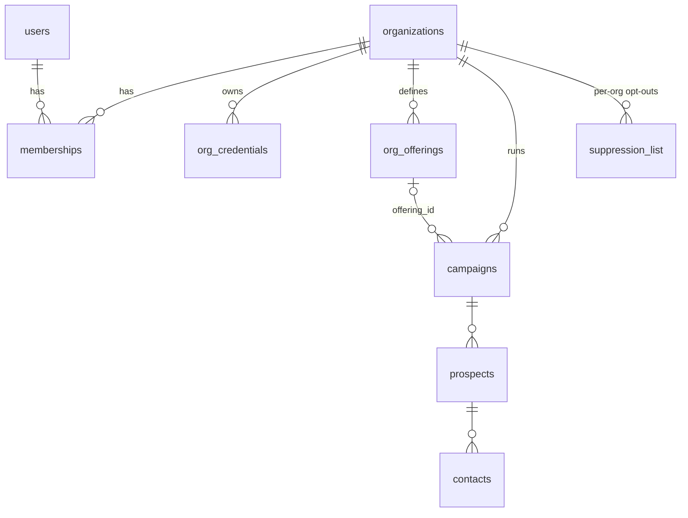

# AI Sales Agent — SaaS Architecture

How the single-operator Appson Sales platform becomes a multi-tenant SaaS:
any company, in any industry, signs up, describes its ideal customer in
plain language, and runs outreach over **Email, WhatsApp and AI voice
calls**. This builds on [architecture.md](architecture.md); everything not
mentioned here stays as described there.

Status (2026-11-13): design locked. `V16__organizations.sql` is written
and passed every check below on a throwaway Postgres 15 + Flyway 9. It has
not been applied to the VPS yet. Nothing else is built.

---

## Where we start

| Area | Today | SaaS needs |
|---|---|---|
| Tenancy | None. Only `campaigns.created_by` and `user_settings.user_id`; no org anywhere in V1–V15. | `organizations` + `memberships`, `org_id` on every tenant table, enforced by Postgres row-level security. |
| Credentials | One global `.env`: one Twilio, one Gmail, one Heyreach, one Apollo, one Anthropic key. | Per-tenant encrypted credential vault. |
| ICP / offering | Hardcoded service lines (`staff_augmentation`, `ai_consulting`) and routing from V13, baked into `services/api/src/lib/campaignPlanner.ts`. | Tenant-defined offering, ICP, tone and routing, generated from a prompt and stored as data. |
| Channels | Email, WhatsApp, LinkedIn. No voice code. | A new AI voice channel. |
| Auth | One operator (`AUTH_MODE=local`, bcrypt hash in env). | Signup, invites, roles, org-scoped sessions. |
| Billing / limits | None. | Plans, usage metering, per-tenant quotas. |
| Compliance | Global suppression list, basic compliance log. | Per-tenant suppression, quiet hours, India DLT/TRAI, WhatsApp opt-in, call-recording consent. |

---

## Decisions locked

1. **BYO first.** Each tenant connects its own Twilio / email / Heyreach /
   Apollo / enrichment / Anthropic accounts. A managed (resold) tier is a
   later upsell. This keeps us from becoming a telecom/WhatsApp reseller
   (deliverability, Meta business verification, DLT/TRAI liability) while
   we land the first paying customers.
2. **Voice via a voice-agent provider** (Vapi / Retell class) on Twilio
   telephony, not a custom speech stack. Provider still open: compare
   per-minute cost and Hindi/Hinglish quality before choosing.
3. **First slice = tenancy foundation + prompt-to-ICP together.** Together
   they deliver "any company can sign up and describe its ICP", which is
   useful on its own. Voice starts only after tenancy is solid.

---

## Build order

| # | Phase | Main deliverables |
|---|---|---|
| 1 | Tenancy | V16 schema (this doc), org-scoped JWT, tenant context per DB connection, V17 RLS, credential vault replacing `.env` keys |
| 2 | Prompt-to-ICP | `campaignPlanner.ts` reads/writes `org_offerings` instead of hardcoded service lines; `POST /api/offerings/generate` |
| 3 | Onboarding + connectors | Signup, invite flow, setup wizard: email → WhatsApp → LinkedIn, each with a "verify credential" step |
| 4 | Voice channel | `voice_channel.py` per the CLAUDE.md "new channel" checklist, provider webhooks, call outcomes into the unified inbox, human handoff |
| 5 | Billing + quotas | Stripe plans, metering per enriched lead / message / call-minute, quota enforcement in the rate limiter |
| 6 | Per-tenant compliance | Org-scoped opt-out, quiet hours by recipient region, DLT/TRAI templates, recording-consent prompts |
| 7 | Hardening | Production dashboard build (not the Vite dev server), offsite backups, monitoring/alerting |

---

## Tenancy model

### New tables (V16)

- **`organizations`** — `id`, `name`, `slug` (unique), `plan`
  (`free|starter|growth|scale|enterprise`), `status`
  (`ACTIVE|SUSPENDED|CANCELLED`).
- **`users`** — global identity; email unique case-insensitively;
  `password_hash` nullable (SSO / invite-pending users).
- **`memberships`** — `(org_id, user_id)` PK, `role`
  `owner|admin|member|viewer`. A user can belong to several orgs.
- **`org_credentials`** — the BYO vault. One row per
  `(org_id, provider, label)`. `secret_enc bytea` is AES-256-GCM ciphertext
  produced by the API before insert (key from env / KMS); Postgres never
  sees plaintext. `meta jsonb` holds non-secret config (from-number,
  sender address, account id). `status` tracks verification.
- **`org_offerings`** — what a tenant sells: `value_proposition`, `tone`,
  `icp jsonb`, `routing jsonb`, and the `source_prompt` it was generated
  from. Replaces the V13 hardcoded service lines for new tenants.

### `org_id` everywhere

`org_id uuid NOT NULL REFERENCES organizations(id)` plus an index is added
to 13 tables: `campaigns`, `prospects`, `contacts`, `messages`,
`conversations`, `conversation_messages`, `meetings`, `suppression_list`,
`compliance_log`, `user_settings`, `prospect_events`, `campaign_audit_log`,
`inbound_events`. `campaigns` also gets `offering_id`, with a composite FK
`(offering_id, org_id) → org_offerings(id, org_id)` so a campaign can only
use an offering from its own org.

The other cross-table FKs (`prospects.campaign_id`, `contacts.prospect_id`,
…) are still single-column, so the schema alone does not stop a row from
pointing at a parent in another org. V17's RLS is what enforces isolation
for those.

Not stamped: `sequence_steps` and `campaign_templates` (only reached via
their campaign) and `poller_state` (process-global).

### Legacy tenant

All existing data is assigned to a fixed legacy org so nothing moves:

| | id | notes |
|---|---|---|
| Org | `00000000-0000-0000-0000-0000000000a1` | slug `appson`, plan `enterprise` |
| Owner user | `00000000-0000-0000-0000-000000000001` | matches the `AUTH_USER_ID` / `DEV_USER_ID` default in `services/api/src/env.ts` |

### Suppression becomes per-org

The three V6 partial unique indexes are rebuilt with `org_id` as the
leading column. One tenant's opt-out must never block, or reveal anything
to, another tenant. App inserts use bare `ON CONFLICT DO NOTHING`, so they
keep working unchanged.

> Open question for phase 6: a global "hard bounce / spam complaint" list
> shared across tenants protects shared sending infrastructure in the
> managed tier. Not needed while every tenant is BYO.

---

## Rollout: two migrations, not one

**V16 (done)** is purely additive. Every new `org_id` has
`DEFAULT '…00a1'`, so the current API, orchestrator and workers, none of
which pass `org_id` yet, keep inserting valid rows into the legacy org.
It is safe to deploy before any code change.

**V17 (after app changes)**:
1. API resolves the org from the JWT (`org_id` + `role` claims) and runs
   every request inside a transaction with
   `SET LOCAL app.current_org = '<uuid>'`.
2. Orchestrator / workers set the same setting from the campaign they are
   processing.
3. Only then: drop the `org_id` defaults, `ENABLE` + `FORCE ROW LEVEL
   SECURITY` with a `USING (org_id = current_setting('app.current_org')::uuid)`
   policy on each stamped table, and run the app under a non-owner role
   (table owners bypass RLS).

Enabling RLS before steps 1–2 ship would make every query return zero rows
in production.

Things to resolve in V17:
- `user_settings` is keyed by `user_id` alone; a user in two orgs needs
  `(org_id, user_id)`. `routes/settings.ts` uses `ON CONFLICT (user_id)`,
  so the key change ships together with that code change.
- `conversations` is unique on `(contact_id, channel)`; contacts are
  already per-org, so this is fine as-is.

---

## Credentials: the vault vs. CLAUDE.md principle 2

CLAUDE.md principle 2 says *all third-party credentials come from
environment variables*. With BYO, tenant credentials live in
`org_credentials` instead. Proposed amendment: **platform** secrets (DB,
vault encryption key, internal tokens) stay env-only; **tenant** secrets
live only as ciphertext in `org_credentials`, decrypted in memory at send
time, never logged, never returned by the API. The principle needs updating
in CLAUDE.md before phase 1 code lands.

Channel classes gain a `from_credentials(org_id)` factory alongside the
planned `from_environment()`; the legacy org keeps reading `.env` until its
keys are moved into the vault.

---

## Prompt-to-ICP

1. Tenant describes the business and ideal customer in free text.
2. `campaignPlanner.ts` (already an LLM planner) gets a new mode that
   returns a structured offering: value proposition, tone, ICP filters
   (titles, industries, sizes, geos, signals) and routing rules.
3. Result is saved to `org_offerings` with the original prompt in
   `source_prompt`; the tenant edits and approves.
4. Campaigns reference it via `campaigns.offering_id`. Routing reads
   `org_offerings.routing` instead of the V13 `service_line` enum. The
   legacy org's two service lines are migrated into two `org_offerings`
   rows.

---

## Voice channel (phase 4 sketch)

- Telephony: tenant's own Twilio number (BYO). Voice agent: provider TBD.
- Follows the CLAUDE.md new-channel checklist: `voice_channel.py`,
  `ChannelRegistry`, rate limits, validator rules, webhook route.
- `channel_type` enum gains `voice` (needs `ALTER TYPE … ADD VALUE`, its own
  migration).
- Call outcome (connected / voicemail / interested / not interested /
  opt-out) and transcript go to `messages` / `conversation_messages`, so
  the unified inbox and funnel work unchanged.
- Compliance: recording-consent disclosure at call start, quiet hours by
  recipient timezone, DND/DLT checks for Indian numbers, spoken opt-out
  writes to `suppression_list`.

---

## Testing V16

Run against a throwaway container, never the VPS first:

1. Fresh `postgres:15-alpine`; Flyway `migrate -target=15`.
2. Seed a campaign → prospect → contact → message → suppression row.
3. Flyway `migrate` (applies V16).
4. Check: backfill to legacy org, app-style inserts without `org_id` still
   succeed, same email suppressible in two orgs, duplicates within one org
   still rejected, `ON CONFLICT DO NOTHING` and
   `ON CONFLICT (user_id)` still behave.

Before deploying to the VPS: take a `pg_dump`, then run Flyway as usual.
